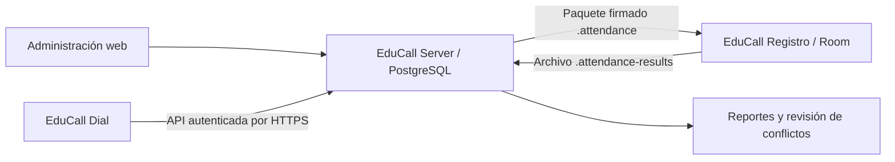

# EduCall

Sistema de llamadas, invitaciones y asistencia compuesto por **tres aplicaciones**:

| Aplicación | Carpeta | Función |
|---|---|---|
| **EduCall Server** | [educall-server](./educall-server/) | Sitio web Django, administración, API y base de datos central. |
| **EduCall Dial** | [educall-dial](./educall-dial/) | App Android para operadores: llamadas, resultados e invitaciones por WhatsApp. Requiere conexión HTTPS al servidor. |
| **EduCall Registro** | [educall-registro](./educall-registro/) | App Android para asistencia offline mediante QR o búsqueda, con importación y exportación de archivos. |



## Inicio con Docker Compose

Esta configuración sirve para **desarrollo y pruebas locales**: usa PostgreSQL persistente y el servidor de desarrollo Django con `DEBUG=1`. No es un despliegue de producción ni ofrece HTTPS. Los comandos siguientes se ejecutan en PowerShell, desde la raíz del repositorio.

### 1. Requisitos

- Docker Desktop instalado y en ejecución, con contenedores Linux y Docker Compose v2.
- Git para descargar el repositorio.
- Puerto local configurado en `EDUCALL_PORT` (`8081` en el ejemplo) disponible.

```powershell
git clone https://github.com/2025je/educall.git
Set-Location .\educall
docker version
docker compose version
```

Si ya tienes el repositorio, abre una terminal en su raíz; no vuelvas a clonarlo.

### 2. Configurar las variables

Copia el ejemplo sin sobrescribir un archivo de configuración existente:

```powershell
Copy-Item .\.env.example .\.env
```

Edita el único archivo `.env` de la raíz. El ejemplo ya contiene las variables que usan Docker Compose, EduCall Server y las compilaciones Android; cambia el puerto o las claves cuando sea necesario. No uses los textos dummy como secretos reales. No compartas ni subas `.env` al repositorio. Las claves de firma pueden quedar vacías para probar llamadas y administración; son necesarias para exportar paquetes de asistencia.

Compose carga `.env` e impone `POSTGRES_HOST=db`, `DJANGO_DEBUG=1` y el puerto interno `5432`. PostgreSQL no publica un puerto al equipo.

Si otro proyecto ya usa el puerto configurado (por ejemplo, EduTrack usa `8080`), cambia `EDUCALL_PORT` en `.env` a un puerto libre y sustituye el puerto en las URL de esta guía. No es necesario detener los contenedores del otro proyecto.

### 3. Construir e iniciar

```powershell
docker compose up --build -d
docker compose ps
docker compose logs -f web
```

El servicio web espera a que PostgreSQL esté disponible y ejecuta las migraciones al iniciar. Espera a que ambos servicios aparezcan saludables. `Ctrl+C` deja de mostrar los registros, sin detener los contenedores.

### 4. Crear el administrador

```powershell
docker compose exec web python manage.py createsuperuser
```

Abre:

- Sitio de operadores: <http://localhost:8081/>.
- Inicio de sesión: <http://localhost:8081/accounts/login/>.
- Administración: <http://localhost:8081/admin/>.

### 5. Comandos habituales

```powershell
# Ver estado y registros
docker compose ps
docker compose logs -f web db

# Validar y ejecutar las pruebas, incluidas las de concurrencia en PostgreSQL
docker compose exec web python manage.py check
docker compose exec web python manage.py makemigrations --check --dry-run
docker compose exec web python manage.py test attendance

# Reconstruir después de modificar el código o las dependencias
docker compose up --build -d

# Detener sin borrar la base de datos
docker compose down
```

Los datos se conservan en el volumen `postgres_data`. **No ejecutes `docker compose down -v` si necesitas conservarlos:** elimina los volúmenes y la base de datos. Cambiar `POSTGRES_PASSWORD` después de inicializar el volumen no cambia automáticamente la contraseña del usuario existente.

El contenedor usa una copia del código: no hay recarga automática ni montaje del repositorio. Reconstruye la imagen para aplicar cambios.

## Configuración inicial de EduCall Server

1. Entra a `/admin/` con el superusuario.
2. Crea las reuniones y sus participantes.
3. Crea los usuarios y asígnales los grupos `ADMINISTRADOR`, `REGISTRAR` u `OPERADOR`, creados automáticamente por las migraciones.
4. Para cada operador, crea un perfil con iniciales únicas de **dos letras mayúsculas**, por ejemplo `JU`. Sin ese perfil no puede recibir llamadas de la cola.
5. Para llamadas salientes, el participante debe tener `contact_authorized=True` y `do_not_contact=False`. Crea las tareas `CallTask` pendientes: no se generan automáticamente para todos los participantes.
6. Crea plantillas activas de WhatsApp. Las variables permitidas son `{{nombre}}`, `{{fecha_reunion}}`, `{{hora_reunion}}`, `{{lugar_reunion}}` y `{{codigo_asistencia}}`.

Los códigos, intentos de llamada, asistencias e historiales generados se consultan desde el administrador. Cambia la reunión de origen mediante el formulario del participante; se conserva el historial y se invalidan los códigos anteriores.

### Grupos de usuarios: funciones y limitaciones

Los grupos predeterminados se configuran en [attendance/signals.py](./educall-server/attendance/signals.py). La tabla describe sus permisos **sin permisos individuales adicionales ni otros grupos**; los controles de cada operación están en [attendance/views.py](./educall-server/attendance/views.py).

| Función | `ADMINISTRADOR` | `REGISTRAR` | `OPERADOR` |
|---|---|---|---|
| Entrar a la pantalla web de operaciones (`/`) | Sí | No; devuelve 403 | Sí |
| Consultar participantes y reuniones activas mediante la API | Sí | Sí | Sí |
| Crear y modificar participantes | Sí | Sí | No |
| Crear tareas de llamada | Sí | Sí | No |
| Crear o modificar reuniones y plantillas de WhatsApp | Sí | No | No |
| Solicitar la siguiente llamada mediante la API | Sí, con perfil de operador | Sí, con perfil de operador; **no puede registrar el resultado** | Sí, con perfil de operador |
| Registrar resultados de llamadas y contactos entrantes | Sí | No | Sí |
| Consultar intentos de llamada | Sí | No | Sí |
| Consultar plantillas activas y preparar mensajes/campañas mediante la API | Sí | Sí | Sí |
| Actualizar el estado manual de sus propios mensajes | Sí | Sí | Sí |
| Descargar el QR de un código vigente | Sí | No | Sí |
| Recibir eventos en tiempo real del servidor | Sí | No | Sí |
| Exportar paquetes de asistencia e importar resultados offline | Sí | No | No |
| Consultar reportes de asistencia y resolver conflictos | Sí | No | No |
| Gestionar usuarios, grupos y permisos | Sí | No | No |

**`ADMINISTRADOR`: administración completa del servidor.** Recibe todos los permisos disponibles al ejecutar las migraciones, incluidos los de usuarios y grupos. Debe asignarse únicamente a personas de confianza: no es un rol administrativo restringido y permite gestionar privilegios. No equivale automáticamente a marcar la cuenta como superusuario o personal.

**`REGISTRAR`: preparación de participantes y tareas.** El nombre del grupo no significa que pueda importar asistencias o resolver conflictos. Sus permisos predeterminados son `add_participant`, `change_participant`, `view_participant`, `add_calltask`, `view_calltask` y `view_meeting`. Actualmente no tiene una pantalla web propia y no puede entrar a la pantalla de operadores. Aunque la API le permite solicitar llamadas si tiene perfil, no tiene `add_callattempt` para registrar sus resultados; no se recomienda usar este grupo por sí solo para atender la cola.

**`OPERADOR`: atención de llamadas e invitaciones.** Sus permisos predeterminados son `view_participant`, `view_calltask`, `add_callattempt`, `view_callattempt`, `view_meeting`, `view_realtimeevent` y `view_attendancecode`. Puede registrar resultados, notas y solicitudes de no volver a contactar a través del flujo de llamadas, pero no editar libremente las fichas de participantes ni crear tareas, reuniones, plantillas o cuentas.

#### Reglas comunes y acceso a las interfaces

- **Cuenta activa:** para iniciar sesión, la cuenta debe estar activa (`is_active`). Una cuenta sin grupos ni permisos adicionales puede autenticarse, pero no tiene acceso funcional a las operaciones protegidas.
- **Grupos acumulables:** una cuenta puede pertenecer a varios grupos; sus permisos se suman a los permisos individuales. Por ejemplo, `REGISTRAR` + `OPERADOR` combina preparación y atención de llamadas.
- **Acceso al administrador Django:** entrar a `/admin/` requiere una cuenta activa con `is_staff` (opción «Es personal»), además de los permisos de cada modelo. Pertenecer a `ADMINISTRADOR` **no activa `is_staff`**; marcar `is_staff` tampoco concede por sí solo permisos de administración. Para crear participantes o tareas desde esa interfaz, un `REGISTRAR` también necesita `is_staff`.
- **Superusuario:** no es un grupo. Una cuenta activa con `is_superuser` dispone de todos los permisos y puede entrar a la pantalla de operaciones sin pertenecer a los grupos anteriores. Para acceder a `/admin/` sigue necesitando `is_staff`.
- **Perfil de operador:** solicitar llamadas y emitir códigos requiere un `OperatorProfile` con iniciales únicas de dos letras mayúsculas, incluso para administradores y superusuarios. Tener un grupo o marcar `is_staff` no crea ese perfil.
- **Límites de las llamadas:** registrar el resultado de una tarea exige que esté asignada al usuario actual y que la asignación no haya vencido; ser administrador no omite ese control.
- **Límites de WhatsApp:** la API autoriza la preparación de mensajes y campañas con `view_participant`, por lo que también lo permite a `REGISTRAR`. Solo se puede contactar a participantes que hayan autorizado el contacto y no estén marcados como «No volver a contactar». Cada usuario solo puede actualizar el estado de sus propios mensajes, incluso si es administrador. No hay envío automático ni confirmación de entrega.
- **Permisos no equivalen a pantallas:** algunas funciones de la tabla solo se ofrecen mediante la API o el administrador Django. Actualmente la web de operaciones no incluye formularios para crear usuarios, participantes, reuniones o tareas. EduCall Dial usa los permisos de la API: poder iniciar sesión no garantiza poder realizar todas las acciones que muestra.
- **Registro offline:** el grupo `REGISTRAR` del servidor no concede ni restringe por sí mismo el uso de EduCall Registro. Esa app trabaja con paquetes firmados y archivos locales; exportar paquetes e importar resultados en el servidor requiere los permisos indicados en la tabla.
- **Migraciones:** al ejecutar `migrate`, se crean los tres grupos y se vuelve a establecer su conjunto de permisos predeterminado. Las modificaciones manuales a los permisos de esos grupos pueden sobrescribirse; para permisos adicionales persistentes, usa grupos propios o permisos individuales.

### Reglas principales

- Las llamadas se asignan transaccionalmente, con vencimiento de diez minutos. Si no contestan, vuelven a estar disponibles después de quince minutos.
- «No volver a contactar» excluye inmediatamente al participante de futuras asignaciones y mensajes.
- Aceptar una invitación genera o reutiliza un código como `JU-03-001`. El número de reunión debe estar entre 1 y 99.
- Abrir WhatsApp no significa que se haya enviado el mensaje; el operador confirma el envío por separado.
- Los conflictos entre asistencias de varios dispositivos se conservan para revisión; no se eliminan silenciosamente.

## Firma de paquetes para EduCall Registro

Genera una pareja Ed25519 **una sola vez**. Con los servicios iniciados:

```powershell
docker compose exec web python -c "import base64; from cryptography.hazmat.primitives.asymmetric.ed25519 import Ed25519PrivateKey; from cryptography.hazmat.primitives import serialization; k=Ed25519PrivateKey.generate(); print('PRIVATE='+base64.b64encode(k.private_bytes(serialization.Encoding.Raw, serialization.PrivateFormat.Raw, serialization.NoEncryption())).decode()); print('PUBLIC='+base64.b64encode(k.public_key().public_bytes(serialization.Encoding.Raw, serialization.PublicFormat.Raw)).decode())"
```

El comando muestra material sensible: ejecútalo en una terminal privada y no publiques su salida.

1. Guarda `PRIVATE` en `ATTENDANCE_SIGNING_PRIVATE_KEY` del `.env` de la raíz.
2. Guarda `PUBLIC` en `ATTENDANCE_SIGNING_PUBLIC_KEY` del mismo archivo.
3. Configura esa misma clave **pública** en EduCall Registro antes de compilarlo.
4. Recrea el servicio para cargar las variables:

```powershell
docker compose up -d --force-recreate web
```

La clave privada nunca debe entrar en el APK ni en Git. Guarda una copia segura fuera del repositorio. Rotar la clave requiere distribuir un nuevo APK con la clave pública correspondiente antes de importar paquetes nuevos.

## Compilar las apps Android

Son dos proyectos independientes y generan APK distintos que pueden instalarse juntos. Puedes compilarlos con Docker o con Android Studio.

### Opción A: Docker (sin instalar Java, Gradle ni Android Studio)

Requiere Docker Desktop con contenedores Linux, conexión a internet y espacio para el SDK, las dependencias y las imágenes (varios GB). Es recomendable disponer de al menos 4 GB de memoria para Docker. La imagen incluye JDK 17, Gradle 8.11.1, SDK 35 y Build-Tools 35.0.0. Su construcción acepta las licencias del SDK de Android; revisa y acepta sus términos antes de usarla.

Desde la raíz del repositorio, construye la imagen una vez:

```powershell
docker compose -f compose.android.yaml build dial
```

Compila EduCall Dial:

```powershell
docker compose -f compose.android.yaml run --rm --no-deps dial
```

Para EduCall Registro, configura `ATTENDANCE_SIGNING_PUBLIC_KEY` en el archivo `.env` de la raíz con la **clave pública** del servidor (consulta la sección de firma de paquetes). También puedes establecerla solo en esta terminal:

```powershell
$env:ATTENDANCE_SIGNING_PUBLIC_KEY = "TU_CLAVE_PUBLICA_ED25519_EN_BASE64"
docker compose -f compose.android.yaml run --rm --no-deps registro
```

Se exige una clave Ed25519 Base64 válida de 32 bytes para compilar Registro mediante Docker. Nunca pases la clave privada. Una variable definida en PowerShell tiene prioridad sobre `.env`; elimina la variable si quieres volver a usar el valor del archivo:

```powershell
Remove-Item Env:\ATTENDANCE_SIGNING_PUBLIC_KEY
```

Los APK se guardan en:

```text
artifacts\android\educall-dial-debug.apk
artifacts\android\educall-registro-debug.apk
```

La configuración Android es independiente de [compose.yaml](./compose.yaml): no requiere las credenciales PostgreSQL ni iniciar el servidor. Solo monta el código de la app correspondiente en modo lectura; compila una copia temporal y no modifica las carpetas originales. Las dependencias Gradle y la clave de firma debug se conservan en volúmenes Docker para acelerar compilaciones posteriores y permitir actualizar los APK debug sin cambiar su firma.

Vuelve a ejecutar `build dial` si cambia el Dockerfile o el script del constructor; para cambios de código basta con repetir `run`. Si una compilación falla, el comando devuelve un error y no publica un APK nuevo; podría quedar un APK de una compilación anterior en la carpeta de salida.

Los contenedores de compilación terminan al generar cada APK. No necesitan acceso USB ni ejecutan un emulador. Copia el APK al teléfono e instálalo autorizando la instalación desde esa fuente; para pruebas por USB usa Android Platform-Tools (`adb install -r ruta-al-apk`) en el equipo.

### Opción B: Android Studio

### Requisitos comunes

- Android Studio compatible con Android Gradle Plugin **8.9.1**.
- **JDK 17** configurado como Gradle JDK.
- Android SDK Platform **35**, Android SDK Build-Tools **35.0.0** y Platform-Tools, instalados desde SDK Manager.
- **Gradle 8.11.1** instalado y disponible en `PATH` para generar el wrapper inicial. Actualmente el repositorio no incluye `gradlew.bat` ni el JAR del wrapper.
- Conexión a internet para descargar las dependencias.
- Teléfono o emulador con Android **9 / API 28 o superior**.

Comprueba las herramientas:

```powershell
java -version
gradle -v
```

Abre por separado [educall-dial](./educall-dial/) y [educall-registro](./educall-registro/) con **File → Open** de Android Studio. Configura JDK 17 en **Settings → Build, Execution, Deployment → Build Tools → Gradle**. Android Studio debe configurar la ruta del SDK en el archivo local de cada proyecto; no subas esa ruta a Git.

### EduCall Dial

Desde la raíz del repositorio:

```powershell
Set-Location .\educall-dial
gradle wrapper --gradle-version 8.11.1
.\gradlew.bat assembleDebug
```

El APK se genera en `educall-dial\app\build\outputs\apk\debug\app-debug.apk`, tomando como referencia la raíz del repositorio.

La app permite iniciar sesión con una cuenta del servidor, solicitar una llamada, abrir el marcador, registrar resultados, buscar contactos y preparar invitaciones de WhatsApp. No guarda la contraseña y el servidor sigue validando permisos y consentimiento de contacto.

**Conexión:** introduce una URL `https://` con certificado válido y accesible desde el dispositivo. El servidor local Docker de esta guía solo ofrece HTTP y, por tanto, **no basta para conectar EduCall Dial**. Necesitas publicar el servidor detrás de HTTPS; no desactives la validación de certificados. `localhost` en un teléfono es el teléfono, no tu computadora.

#### Probar EduCall Dial en una red local

Para pruebas sin dominio público, el proyecto incluye un proxy HTTPS con una CA local. Esta opción es solo para desarrollo: el APK debug confiará en certificados instalados por el usuario; las versiones release seguirán confiando únicamente en las CA del sistema.

1. En el `.env` de la raíz, configura los nombres/IP que usarás. Para un emulador Android, `10.0.2.2` apunta a la computadora. Para un teléfono físico, usa la IP LAN de la computadora (por ejemplo, `192.168.1.25`) y asígnala en el router para que no cambie:

   ```dotenv
   EDUCALL_LOCAL_HTTPS_HOSTS=10.0.2.2, 192.168.1.25
   EDUCALL_LOCAL_HTTPS_DEFAULT_SNI=192.168.1.25
   EDUCALL_HTTPS_BIND_IP=192.168.1.25
   ```

   En un teléfono, usa la misma IP LAN para el host, `EDUCALL_LOCAL_HTTPS_DEFAULT_SNI` y `EDUCALL_HTTPS_BIND_IP`, y permite conexiones entrantes al puerto TCP 443 en el firewall de Windows. Para usar solo el emulador, basta con `EDUCALL_LOCAL_HTTPS_HOSTS=10.0.2.2`; puedes omitir las otras dos variables.

2. Desde la raíz del repositorio, inicia el proxy junto con el servidor. Reconstruye EduCall Dial para incluir la confianza de certificados de desarrollo:

   ```powershell
   docker compose -f compose.yaml -f compose.local-https.yaml up --build -d
   docker compose -f compose.android.yaml run --rm dial
   ```

   El segundo comando compila el APK en `artifacts/android/educall-dial-debug.apk`. Instálalo en el dispositivo o emulador.

3. Exporta el certificado raíz de Caddy:

   ```powershell
powershell.exe -NoProfile -ExecutionPolicy Bypass -File .\scripts\export-local-ca.ps1
   ```

El archivo se guarda como `educall-local-root.crt` en la raíz. `-ExecutionPolicy Bypass` solo aplica a este proceso de PowerShell y no cambia la política del equipo. El script solo exporta el certificado público, nunca la clave privada de la CA. Si el archivo ya existe, se niega a sobrescribirlo; usa `-Force` únicamente si quieres reemplazarlo.

4. Copia `educall-local-root.crt` al teléfono (por ejemplo, por USB) e instálalo en Android como certificado de CA desde los ajustes de seguridad del dispositivo. Luego, en EduCall Dial, introduce `https://10.0.2.2` en el emulador o `https://192.168.1.25` en el teléfono. El teléfono y la computadora deben estar en la misma red Wi-Fi.

La CA instalada permite confiar en certificados locales en el APK debug; no instales una CA que no controles. Para uso fuera de la red local, configura un dominio con certificado público válido y sigue las instrucciones de despliegue; no distribuyas el APK debug.

#### Permitir todos los dispositivos de la red en AVG

No es necesario registrar cada teléfono ni añadir sus IP a `DJANGO_ALLOWED_HOSTS`: esa variable contiene la dirección del servidor, no las de los clientes.

En AVG, abre **Configuración → Protección básica → Cortafuegos mejorado → Ver reglas del Cortafuegos → Reglas de red** (o **Reglas de paquetes**, según la versión) y edita la regla de EduCall:

| Campo | Valor |
|---|---|
| Acción | Permitir |
| Protocolo | TCP |
| Dirección de conexión | Entrada |
| IP remota | `192.168.1.1-192.168.1.254`, para una red `192.168.1.0/24` |
| Puerto local | `443` |
| Puerto remoto | Vacío / Todos |
| Perfil | El de la red local actual |

Comprueba la subred de tu router antes de usar ese rango y adáptalo si es diferente. Mantén AVG activado; no permitas todos los puertos de Docker ni todas las direcciones de Internet. Si hay una regla personalizada de bloqueo anterior, revisa su prioridad. Cada teléfono debe instalar la CA local y conectarse a la misma URL HTTPS del servidor; sus usuarios siguen necesitando una cuenta y los permisos correspondientes.

#### Cierre de sesión desde EduCall Dial

Django rota la cookie CSRF al autenticar al usuario. La app utiliza el valor vigente de esa cookie en cada operación POST, incluido el cierre de sesión; no se debe reutilizar el token del formulario anterior al inicio de sesión. Si tenías una versión anterior del APK que devolvía HTTP 403 al salir, recompila e instala EduCall Dial con `docker compose -f compose.android.yaml run --rm dial`.

En otra PC, inicia Caddy y vuelve a ejecutar `.\scripts\export-local-ca.ps1`: el volumen local de Docker tendrá su propia CA, distinta de la anterior. Instala el certificado exportado de esa PC en el teléfono. Si conservas y trasladas explícitamente el volumen `caddy_data`, la CA existente se conserva y no es necesario instalar otra.

### EduCall Registro

En [gradle.properties](./educall-registro/gradle.properties) añade la clave pública obtenida del servidor, sin comillas:

```properties
attendancePublicKey=TU_CLAVE_PUBLICA_ED25519_EN_BASE64
```

No uses la clave privada. Sin una clave pública válida, la app no podrá verificar los paquetes.

Desde una nueva terminal en la raíz del repositorio:

```powershell
Set-Location .\educall-registro
gradle wrapper --gradle-version 8.11.1
.\gradlew.bat assembleDebug
```

El APK se genera en `educall-registro\app\build\outputs\apk\debug\app-debug.apk`, tomando como referencia la raíz del repositorio.

### Instalar, probar y distribuir

Conecta un dispositivo con depuración USB habilitada o inicia un emulador. Desde cada proyecto:

```powershell
.\gradlew.bat installDebug
```

También puedes usar **Run** en Android Studio. Autoriza la conexión USB en el teléfono.

Para distribuir fuera de pruebas, usa **Build → Generate Signed App Bundle or APK**, crea o selecciona tu almacén de claves y elige APK o AAB según el canal. Conserva ese almacén y su contraseña fuera del repositorio: los necesitas para publicar actualizaciones. No distribuyas el APK debug como versión de producción.

Se verificó la compilación Docker de ambas apps y la firma de sus APK debug. Registro se compiló para esta comprobación con una clave pública temporal: recompílalo con la clave de tu servidor antes de importar paquetes reales. Los APK generados quedan fuera de Git. Siguen pendientes las pruebas funcionales en un teléfono o emulador (cámara, QR, llamadas, WhatsApp y persistencia).

## Uso offline de EduCall Registro

1. En el servidor, exporta el paquete firmado de la reunión mediante `GET /api/v1/meetings/{meeting_id}/package/` con una sesión autorizada.
2. Transfiere el archivo `.attendance` por un canal controlado e impórtalo mediante el selector de documentos de Registro.
3. La app verifica firma Ed25519, hashes y estructura antes de guardar los datos en Room.
4. Selecciona y confirma explícitamente la reunión de trabajo. La selección persiste y no cambia por escanear, buscar o importar.
5. Registra por QR o búsqueda de nombre, teléfono o código. La cámara es opcional; se evitan duplicados locales por participante y reunión efectiva.
6. Exporta los resultados `.attendance-results`. Las asistencias permanecen en el dispositivo.
7. Importa el archivo en el servidor mediante `POST /api/v1/attendance/import/`, campo multipart `file`, con una cuenta autorizada.

### Formatos y límites

- `.attendance` es un ZIP con `manifest.json`, `manifest.sig`, `meeting.json`, `participants.json` y `verification.json`. El manifiesto firmado incluye hashes SHA-256.
- El QR contiene únicamente el código de asistencia, no el nombre ni el teléfono. Un QR copiado no demuestra identidad.
- Los paquetes contienen datos personales en texto plano: protege su transferencia y el acceso al dispositivo.
- Por defecto no se permite asistencia cruzada entre reuniones. Habilitarla amplía los datos exportados.
- Un dispositivo offline no conoce cambios posteriores a la exportación. El servidor vuelve a validar los registros y deja los casos correspondientes en revisión.
- Los resultados Android conservan UUID estables para importación idempotente, pero no tienen firma de dispositivo: no prueban criptográficamente quién registró cada asistencia.
- No hay sincronización automática de dispositivos, envío automático de WhatsApp, confirmación de entrega ni adjunto automático del QR. El operador confirma el envío; la imagen QR se adjunta manualmente cuando corresponda.

## Ejecutar Django sin Docker

Requiere Python 3.11 o superior; se validó inicialmente con Python 3.12. Desde la raíz:

```powershell
Set-Location .\educall-server
py -m venv .venv
.\.venv\Scripts\Activate.ps1
python -m pip install -r requirements.txt
if (-not (Test-Path ..\.env)) {
    Copy-Item ..\.env.example ..\.env
}
Get-Content ..\.env | ForEach-Object {
    if ($_ -match '^\s*([^#=]+)=(.*)$') {
        [Environment]::SetEnvironmentVariable($matches[1].Trim(), $matches[2], 'Process')
    }
}
$env:DJANGO_DEBUG = "1"
$env:POSTGRES_DB = ""
$env:SQLITE_PATH = (Join-Path (Get-Location) "db.sqlite3")
python manage.py migrate
python manage.py createsuperuser
python manage.py runserver
```

Abre <http://127.0.0.1:8000/>. Django no carga archivos `.env` por sí solo; los comandos anteriores importan el único `.env` de la raíz y fuerzan SQLite para este modo local.

## Producción y HTTPS

El Compose incluido **no es apto para producción**. Antes de publicar:

- Usa un servidor WSGI/ASGI de producción y sirve los archivos estáticos recopilados con `collectstatic`.
- Configura TLS con certificado válido y un dominio accesible desde Android.
- Establece `DJANGO_DEBUG=0`, una `DJANGO_SECRET_KEY` propia y `DJANGO_ALLOWED_HOSTS` con los dominios reales.
- Mantén PostgreSQL: fuera de DEBUG se rechaza SQLite por no ofrecer los bloqueos de fila necesarios para la cola.
- Conserva las cookies seguras y la redirección HTTPS; revisa la configuración del proxy sin confiar en cabeceras de clientes no fiables.
- Protege y respalda PostgreSQL, la clave privada Ed25519 y los secretos de despliegue.

El puerto del Compose está ligado a `127.0.0.1`: no expone la aplicación a toda la red. No publiques este servidor de desarrollo en internet como sustituto de un despliegue HTTPS.

## API y pruebas

La API vive bajo `/api/v1/` y requiere sesión Django y los permisos de cada operación. Los POST requieren CSRF. EduCall Dial usa las mismas reglas que el sitio web.

| Método y ruta relativa | Función |
|---|---|
| `POST /calls/next/` | Solicitar la siguiente llamada. |
| `POST /calls/{task_id}/result/` | Registrar resultado y notas. |
| `POST /calls/inbound/` | Registrar contacto entrante. |
| `GET /participants/search/?q=...` | Buscar participantes. |
| `GET /whatsapp/templates/` | Consultar plantillas activas. |
| `POST /whatsapp/prepare/` | Preparar un mensaje autorizado. |
| `POST /whatsapp/campaigns/prepare/` | Preparar entre 1 y 100 mensajes con plantillas por destinatario. |
| `POST /whatsapp/{log_id}/status/` | Actualizar el estado manual de un mensaje. |
| `POST /mobile/logout/` | Cerrar la sesión móvil. |
| `GET /meetings/` | Listar reuniones activas. |
| `GET /meetings/{meeting_id}/package/` | Descargar un paquete firmado. |
| `GET /codes/{code_id}/qr/` | Descargar el QR PNG de un código vigente. |
| `POST /attendance/import/` | Importar resultados offline. |
| `GET /attendance/report/{meeting_id}/` | Consultar totales de la reunión. |
| `POST /attendance/conflicts/{id}/resolve/` | Resolver un conflicto conservando los registros. |
| `GET /attendance/stream/` | Recibir eventos SSE publicados después del commit. |

Sin Docker, ejecuta desde la carpeta del servidor:

```powershell
python manage.py check
python manage.py makemigrations --check --dry-run
python manage.py test attendance
```

Las pruebas cubren asignación, permisos, llamadas, consentimiento, códigos, paquetes firmados, estados de WhatsApp e importación con conflictos. Con SQLite se omiten las pruebas que necesitan bloqueo de filas; usa PostgreSQL mediante Compose para ejecutarlas. Los eventos en tiempo real usan SSE y una tabla persistente, no Django Channels/WebSockets.

Validación realizada: construcción y arranque de Compose con servicios saludables, inicio de sesión HTTP 200, migraciones sin cambios pendientes y **22 pruebas aprobadas en PostgreSQL, sin omisiones**. También se generaron ambos APK con Docker y se verificaron sus firmas. Esto no sustituye las pruebas Android en dispositivo pendientes.
