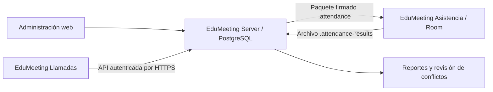

# EduMeeting

Sistema de llamadas, invitaciones y asistencia compuesto por **tres aplicaciones**:

| Aplicación | Carpeta | Función |
|---|---|---|
| **EduMeeting Server** | [edumeeting-server](./edumeeting-server/) | Sitio web Django, administración, API y base de datos central. |
| **EduMeeting Llamadas** | [edumeeting-llamadas](./edumeeting-llamadas/) | App Android para operadores: llamadas, resultados e invitaciones por WhatsApp. Requiere conexión HTTPS al servidor. |
| **EduMeeting Asistencia** | [edumeeting-asistencia](./edumeeting-asistencia/) | App Android para asistencia offline mediante QR o búsqueda, con importación y exportación de archivos. |



## Inicio con Docker Compose

Esta configuración sirve para **desarrollo y pruebas locales**: usa PostgreSQL persistente, Redis, Django ASGI con Daphne y `DEBUG=1`, y procesos Celery de tareas y programación. No es un despliegue de producción ni ofrece HTTPS sin el complemento local. Los comandos siguientes se ejecutan en PowerShell, desde la raíz del repositorio.

### 1. Requisitos

- Docker Desktop instalado y en ejecución, con contenedores Linux y Docker Compose v2.
- Git para descargar el repositorio.
- Puerto local configurado en `EDUMEETING_PORT` (`8081` en el ejemplo) disponible.

```powershell
git clone https://github.com/2025je/EduMeeting.git
Set-Location .\EduMeeting
docker version
docker compose version
```

Si ya tienes el repositorio, abre una terminal en su raíz; no vuelvas a clonarlo.

### 2. Configurar las variables

Copia el ejemplo sin sobrescribir un archivo de configuración existente:

```powershell
Copy-Item .\.env.example .\.env
```

Edita el único archivo `.env` de la raíz. El ejemplo ya contiene las variables que usan Docker Compose, EduMeeting Server y las compilaciones Android; cambia el puerto o las claves cuando sea necesario. No uses los textos dummy como secretos reales. No compartas ni subas `.env` al repositorio. Las claves de firma pueden quedar vacías para probar llamadas y administración; son necesarias para exportar paquetes de asistencia.

Compose carga `.env` e impone `POSTGRES_HOST=db`, `DJANGO_DEBUG=1` y el puerto interno `5432`. PostgreSQL no publica un puerto al equipo.

Si otro proyecto ya usa el puerto configurado (por ejemplo, EduTrack usa `8080`), cambia `EDUMEETING_PORT` en `.env` a un puerto libre y sustituye el puerto en las URL de esta guía. No es necesario detener los contenedores del otro proyecto.

### 3. Construir e iniciar

```powershell
docker compose up --build -d
docker compose ps
docker compose logs -f web
```

El servicio web espera a que PostgreSQL y Redis estén disponibles, ejecuta las migraciones y recopila los archivos estáticos al iniciar. Celery worker y scheduler arrancan después del servidor web. Espera a que los servicios web, db y redis aparezcan saludables. `Ctrl+C` deja de mostrar los registros, sin detener los contenedores.

### 4. Crear el administrador

```powershell
docker compose exec web python manage.py createsuperuser
```

Abre:

- Sitio de operadores: <http://localhost:8081/>.
- Inicio de sesión: <http://localhost:8081/accounts/login/>.
- Administración: <http://localhost:8081/admin/>.

### 5. Comandos habituales

```powershell
# Ver estado y registros
docker compose ps
docker compose logs -f web db

# Validar y ejecutar las pruebas, incluidas las de concurrencia en PostgreSQL
docker compose exec web python manage.py check
docker compose exec web python manage.py makemigrations --check --dry-run
docker compose exec web python manage.py test attendance

# Reconstruir después de modificar el código o las dependencias
docker compose up --build -d

# Detener sin borrar la base de datos
docker compose down
```

Los datos se conservan en el volumen `postgres_data`. **No ejecutes `docker compose down -v` si necesitas conservarlos:** elimina los volúmenes y la base de datos. Cambiar `POSTGRES_PASSWORD` después de inicializar el volumen no cambia automáticamente la contraseña del usuario existente.

Los contenedores web, worker y scheduler usan la misma imagen y una copia del código: no hay recarga automática ni montaje del repositorio. Reconstruye y recrea los tres para aplicar cambios.

## Servicios de API, tiempo real y tareas

Las integraciones conservan las sesiones web con CSRF y los contratos usados por las apps Android:

| Componente | Uso en EduMeeting |
|---|---|
| Django Channels + Redis | WebSocket por reunión en `/ws/attendance/<meeting_id>/`, autenticado con la sesión web y validación del origen. Solo operadores asignados o superusuarios autorizados; se revalidan permisos en cada evento y ping. |
| Celery + Redis | Exportación de paquetes firmados de asistencia fuera de la petición web. Worker con dos procesos y scheduler para purgar contenidos caducados cada hora. |
| drf-spectacular | OpenAPI en `/api/v1/schema/` y Swagger en `/api/v1/docs/`, exclusivos de superusuarios. Los recursos Swagger son locales, sin CDN. |
| SimpleJWT | Autenticación Bearer adicional para clientes API; las apps móviles existentes siguen usando sesiones. |
| django-filter | Filtros validados de participantes y reportes, siempre dentro de la reunión autorizada y con la paginación anterior. |
| django-cors-headers | CORS de API mediante lista explícita; cerrado por defecto. No se necesitan permisos CORS para las apps Android nativas. |
| django-auditlog | Historial automático de cuentas, grupos, perfiles, reuniones, asignaciones y participantes. No registra contraseñas ni teléfonos; enmascara nombres de participantes. Se conserva `AuditEvent` como historial funcional. |

### Arranque y actualización

Desde la raíz, conserva el complemento HTTPS si lo utilizas:

```powershell
docker compose -f compose.yaml -f compose.local-https.yaml up --build -d --wait
docker compose -f compose.yaml -f compose.local-https.yaml ps
docker compose -f compose.yaml -f compose.local-https.yaml logs --tail=100 worker scheduler
```

Sin HTTPS local: `docker compose up --build -d --wait`. Redis no publica puertos al equipo y conserva su cola en `redis_data`; no elimines el volumen si hay trabajos pendientes. Los resultados de las exportaciones se almacenan en PostgreSQL para que web y worker no dependan de un directorio compartido. Esta configuración sigue siendo local: en producción se necesitan secretos reales, TLS, permisos de red internos, límites/monitorización y servir estáticos con un servidor adecuado, sin `DEBUG`.

### Eventos de asistencia

El operador web prefiere WebSocket y vuelve a SSE (`/api/v1/attendance/stream/`) si el canal se desconecta. Los eventos siguen persistidos en `RealtimeEvent` y solo se publican tras confirmar la transacción; una caída de Redis se registra y no revierte una operación ya confirmada. WebSocket es una notificación en vivo, no un registro con reproducción: después de una reconexión consulta la API para obtener el estado actual. El canal usa la sesión web, no tokens en la URL. Caddy admite WebSockets sin configuración adicional.

### Exportación en segundo plano

En **Gestionar reuniones**, solo el superusuario ve **Exportar asistencia**. La pantalla consulta el trabajo y ofrece la descarga cuando termina. El flujo API es:

1. `POST /api/v1/meetings/<meeting_id>/exports/` devuelve `202` con `id`, `status`, `status_url`, `download_url`, `error` y `expires_at`. Si no se puede encolar, devuelve `503` y registra la causa.
2. `GET /api/v1/exports/<job_id>/` devuelve el estado `pending`, `running`, `succeeded` o `failed`. Solo el superusuario solicitante puede consultar o descargar su trabajo.
3. `GET /api/v1/exports/<job_id>/download/` entrega el archivo `.attendance` firmado; no se publica mediante una URL de medios anónima. Caduca a las 24 horas y se purga su contenido con Celery beat. El registro del trabajo se conserva.

El worker revalida que la cuenta siga activa y sea superusuario. No reintenta automáticamente la generación de paquetes; los fallos quedan explícitos y el usuario puede solicitar un trabajo nuevo. La exportación síncrona anterior (`GET /api/v1/meetings/<meeting_id>/package/`) permanece disponible. La clave privada de firma solo pertenece al servidor/worker y nunca debe incluirse en Android.

### JWT y CORS

- `POST /api/v1/auth/token/`: JSON `{"username":"USUARIO","password":"..."}` devuelve `access` y `refresh`. Se limita a diez solicitudes por minuto y dirección IP en cada proceso web.
- Envía `Authorization: Bearer <access>` y `X-EduMeeting-Meeting: <uuid>` para las operaciones de reunión. Se aplican los mismos permisos que a las sesiones.
- `POST /api/v1/auth/token/refresh/`: JSON `{"refresh":"..."}` rota el refresh e invalida el anterior.
- `POST /api/v1/auth/token/revoke/`: requiere autenticación y un refresh propio; lo añade a la lista negra. Los access ya emitidos caducan en 15 minutos; un refresh dura un día. Desactivar una cuenta o cambiar su contraseña invalida su uso. El logout de sesión móvil no revoca tokens JWT independientes.
- Las sesiones siguen exigiendo CSRF para POST/PATCH; JWT no sustituye ni desactiva esa protección.
- Define `DJANGO_CORS_ALLOWED_ORIGINS=https://portal.ejemplo.com,https://otro.ejemplo.com` en `.env` solo cuando exista un frontend en esos orígenes. No uses comodines. CORS no autoriza cuentas ni abre las cookies de sesión a otros sitios; el frontend externo debe usar Bearer. `DJANGO_ALLOWED_HOSTS` identifica al servidor y es una lista distinta.

La auditoría automática se consulta desde `/admin/auditlog/logentry/`, reservado al superusuario. Las operaciones de inicialización de grupos durante las migraciones no se registran como cambios de usuario.

### Validación del backend

```powershell
docker compose exec web python manage.py check
docker compose exec web python manage.py makemigrations --check --dry-run
docker compose exec web python manage.py spectacular --validate --fail-on-warn --file /tmp/edumeeting-openapi.yaml
docker compose exec web python manage.py test api attendance --noinput
docker compose exec worker celery -A config inspect ping --timeout=5
```

Las pruebas de servicios reales se activan expresamente con Redis en ejecución:

```powershell
docker compose exec -e EDUMEETING_TEST_LIVE_SERVICES=1 web python manage.py test api.test_live_services --noinput
```

Comprueban la entrega de eventos mediante Redis y generan un paquete firmado con un worker Celery temporal, una cola exclusiva y la base de datos de pruebas. El worker temporal se detiene al finalizar. No ejecutes dos suites a la vez sobre la misma base de datos de pruebas.

## Configuración inicial de EduMeeting Server

1. El superusuario crea las cuentas y asigna los grupos `ADMINISTRADOR`, `REGISTRAR` u `OPERADOR`, desde **Usuarios y grupos** (`/users/`), desde `/admin/` o con el comando interactivo siguiente.
2. El usuario `ADMINISTRADOR` crea, edita o desactiva reuniones desde **Gestionar reuniones** (`/meetings/` o EduMeeting Llamadas), una vista independiente de la reunión activa. Cada reunión nueva queda bajo su administración exclusiva.
3. Selecciona la reunión activa y asigna cuentas existentes de registro y operación. Una cuenta puede estar asignada a varias reuniones y una reunión puede tener varios miembros de cada rol.
4. Los registradores seleccionan una reunión asignada y registran nombre, teléfono y autorización de contacto. Se crea automáticamente una tarea de llamada para esa persona en esa reunión.
5. Los operadores seleccionan una reunión asignada para solicitar el siguiente teléfono o buscar/listar sus participantes. Cada operador necesita un perfil con iniciales únicas de **dos letras mayúsculas**, por ejemplo `JU`.
6. El superusuario configura plantillas activas de WhatsApp. Las variables permitidas son `{{nombre}}`, `{{fecha_reunion}}`, `{{hora_reunion}}`, `{{lugar_reunion}}` y `{{codigo_asistencia}}`.

Los códigos, intentos de llamada, asistencias e historiales generados se consultan desde el administrador. Cambia la reunión de origen mediante el formulario del participante; se conserva el historial y se invalidan los códigos anteriores.

### Interfaz web

La interfaz está inspirada en [Zensical](https://zensical.org/contributing/): barra superior translúcida (con desenfoque) con el logo, pestañas **Inicio** / **Reuniones**, la reunión activa como píldora, el usuario y **Salir**; menú lateral izquierdo con iconos (usuario, selector de reunión activa, Inicio con las secciones de tus roles, Gestionar reuniones y roles en la reunión), migas de pan (Inicio › Reunión), contenido central y columna derecha «En esta página» en pantallas anchas. En móviles el menú se abre con el botón ☰.

- En Inicio, la reunión activa muestra tarjetas (icono, título, descripción y «→ enlace») que llevan a cada sección permitida por tus roles: asignar usuarios, estadísticas, registrar persona, cola de llamadas, buscar participante y WhatsApp.
- Solo el superusuario ve la pestaña **Usuarios** y el enlace lateral **Usuarios y grupos** (`/users/`). Desde la misma pantalla puede crear cuentas, editar nombre de usuario, nombre, apellidos y grupos, cambiar la contraseña y activar o desactivar las demás cuentas. No se solicita correo electrónico; los correos existentes se conservan sin modificarse. Al editar, dejar ambos campos de contraseña vacíos conserva la actual; las contraseñas nuevas requieren confirmación y cumplen los validadores de Django. Los operadores necesitan iniciales únicas de dos letras, cuyo perfil se crea o actualiza con el formulario. La lista incluye otros superusuarios y cuentas inactivas; no permite modificar la cuenta propia ni conceder o retirar privilegios de superusuario/personal (eso sigue en `/admin/`). No depende de la reunión activa y las demás cuentas no pueden acceder ni mediante URL directa. Los cambios de estado requieren POST con CSRF y desactivar impide el acceso sin borrar datos, asignaciones ni historial. Se registra quién realizó cada cambio, sin guardar contraseñas en el historial.
- El botón de sol/luna cambia entre tema claro (blanco) y oscuro (#0B0C0F); la preferencia se guarda en el navegador (por defecto sigue la del sistema).
- En **Usuarios y grupos**, el campo **Iniciales de operador** solo se habilita al marcar el grupo `OPERADOR` y se deshabilita al desmarcarlo. El servidor ignora las iniciales enviadas para otros grupos; si se retira el grupo de un operador existente, conserva su perfil e iniciales sin modificarlos.
- Usa fuentes del sistema y no carga recursos externos: funciona sin internet dentro de la red local.
- Los campos de texto y áreas de texto de los formularios web (incluido `/admin/`) convierten la entrada a **MAYÚSCULAS** al escribir, pegar y enviar. Se exceptúan contraseñas, correos, nombres de usuario y valores técnicos (ocultos, fechas, números, URL y tipo interno de mensaje). Se conserva la selección del cursor y las variables `{{nombre}}` de las plantillas. La conversión cambia el valor enviado, no es solo visual; no modifica registros existentes por sí sola ni las entradas de las aplicaciones Android o API.
- En el formulario **Usuarios y grupos** hay una excepción específica: **Usuario** se convierte a MAYÚSCULAS; **Nombre** y **Apellidos** conservan la escritura introducida y no se solicita correo electrónico. Las contraseñas tampoco se transforman. El inicio de sesión conserva el nombre de usuario escrito para mantener el acceso a cuentas anteriores.
- En **Usuarios y grupos**, los grupos se muestran como **Administrador de reuniones**, **Registrador de participantes** y **Operador de llamadas**, tanto en el formulario como en el listado. Sus identificadores internos siguen siendo `ADMINISTRADOR`, `REGISTRAR` y `OPERADOR`, sin cambiar permisos ni asignaciones. Los grupos adicionales conservan su nombre.
- EduMeeting Llamadas usa esos mismos nombres en sus roles y en la asignación de equipos. EduMeeting Asistencia no utiliza grupos de cuentas: su «Operador» es un identificador local de quien registra asistencias, no el rol de llamadas.
- Las consultas de EduMeeting Llamadas pasan por Retrofit y OkHttp, con cookies de sesión aisladas por conexión, CSRF de Django, selección de reunión y HTTPS obligatorio. Se mantienen los contratos de la API y los errores se muestran explícitamente; una respuesta exitosa que no sea un objeto JSON se rechaza. La compilación Docker de Llamadas ejecuta sus pruebas de red con MockWebServer antes de generar el APK. Asistencia sigue sin conexión y no necesita cliente Retrofit.
- Ambas apps usan **DataStore** para preferencias, migrando el tema que antes estaba en SharedPreferences. Llamadas recuerda también la URL del último inicio de sesión correcto, pero no contraseñas ni sesiones. Asistencia ya utiliza **Room** para reuniones, participantes, asistencias e historial local y **DataStore** para reunión seleccionada e identificación del dispositivo/registrador. No se añade Room a Llamadas porque sus datos siguen en el servidor, ni WorkManager: no hay sincronización automática ni trabajos diferidos; reintentar llamadas o registros en segundo plano podría duplicar operaciones o usar asignaciones vencidas.
- Plantilla base: `edumeeting-server/templates/attendance/base.html`; estilos: `attendance/static/attendance/app.css`; tema: `theme.js`.

### Crear una cuenta de cada grupo sin entrar a `/admin/`

El comando [create_role_users](./edumeeting-server/attendance/management/commands/create_role_users.py) crea **tres cuentas nuevas en una sola ejecución**: una `ADMINISTRADOR`, una `REGISTRAR` y una `OPERADOR`. Desde la raíz del repositorio, actualiza primero el servidor para incluir el comando:

```powershell
docker compose -f compose.yaml -f compose.local-https.yaml up --build -d web
docker compose exec web python manage.py create_role_users
```

Si no usas el HTTPS local opcional, reconstruye con `docker compose up --build -d web`.

El comando solicita el nombre de usuario, la contraseña y su confirmación para cada cuenta. Las contraseñas se introducen de forma oculta, se validan con las reglas de Django y solo se guarda su hash en la base de datos; no se muestran ni se guardan en texto plano en archivos o en `.env`. Si la terminal no permite ocultarlas, el comando se cancela. Ejecútalo en una terminal interactiva; no uses `exec -T` ni redirijas contraseñas.

Al final solicita las iniciales únicas del operador (por ejemplo, `JU`) y crea automáticamente su perfil. Las letras minúsculas se normalizan a mayúsculas. Las cuentas de administrador y registrador no reciben perfil de operador.

Las tres cuentas están activas, **no son superusuarios y no tienen acceso a `/admin/`**. La bandera opcional siguiente únicamente marca las cuentas como personal:

```powershell
docker compose exec web python manage.py create_role_users --staff
```

`--staff` solo activa «Es personal» y **no habilita `/admin/`**, ahora reservado a superusuarios. Cada cuenta conserva exclusivamente las funciones de su grupo y necesita las asignaciones correspondientes a reuniones. El administrador funcional no crea cuentas: solo asigna cuentas existentes.

El comando no modifica cuentas existentes ni restablece contraseñas. Si un nombre ya existe, una contraseña es inválida, las iniciales están ocupadas o falla la creación, no se guarda ninguna de las tres cuentas. Para crear otro conjunto, vuelve a ejecutarlo con nombres e iniciales diferentes. Los grupos deben existir previamente (`python manage.py migrate`).

Sin Docker, con el entorno Django configurado y desde `edumeeting-server`, usa `python manage.py create_role_users` (opcionalmente `--staff`).

### Grupos de usuarios: funciones y limitaciones

Los grupos se configuran en [attendance/signals.py](./edumeeting-server/attendance/signals.py). Además del grupo, el servidor valida la pertenencia a la reunión mediante [attendance/access.py](./edumeeting-server/attendance/access.py). Los permisos globales o individuales no sustituyen esa asignación.

| Función | `ADMINISTRADOR` | `REGISTRAR` | `OPERADOR` |
|---|---|---|---|
| Crear, editar y activar/desactivar reuniones | Sí, en una vista independiente de la reunión activa; queda como único administrador | No | No |
| Asignar registradores y operadores existentes | Solo en sus reuniones | No | No |
| Ver estadísticas de reuniones y actividad de sus usuarios | Solo en sus reuniones | No | No |
| Registrar datos de personas y añadirlas automáticamente a la cola | No | Solo en reuniones asignadas | No |
| Solicitar siguiente llamada, buscar y listar teléfonos | No | No | Solo en reuniones asignadas |
| Registrar resultados y contactos entrantes | No | No | Solo en la reunión activa |
| Preparar WhatsApp y descargar QR vigentes | No | No | Solo en la reunión activa |
| Crear cuentas, cambiar grupos o administrar datos globales | No | No | No; reservado al superusuario |
| Exportar/importar asistencia offline o resolver conflictos | No | No | No; reservado al superusuario |

**`ADMINISTRADOR`: responsable de sus reuniones.** Puede crear varias reuniones, cada una con un único administrador. Asigna y retira registradores/operadores existentes y consulta estadísticas de cada reunión: personas registradas, llamadas pendientes y finalizadas, intentos y aceptaciones, con desglose por usuario. No crea cuentas ni gestiona permisos globales, no registra personas y no atiende llamadas salvo que también tenga esos roles y esté asignado como miembro.

**`REGISTRAR`: registro de personas a llamar.** Introduce nombre completo, teléfono y autorización de contacto en la reunión activa asignada. La persona y su tarea de llamada se guardan en una sola transacción y se atribuyen al registrador. Puede registrar en varias reuniones, pero no crear reuniones, asignar usuarios, consultar estadísticas ni acceder a la cola telefónica para operarla. No puede cambiar la reunión mediante campos enviados en el formulario.

**`OPERADOR`: atención de las colas asignadas.** Puede solicitar el siguiente teléfono elegible o buscar/listar personas de la reunión activa. Registra resultados y notas, gestiona contactos entrantes e invitaciones por WhatsApp y descarga QR vigentes de esa reunión. No crea reuniones ni personas, no asigna usuarios y no consulta estadísticas administrativas. Una asignación en una reunión no concede acceso a los teléfonos de otra.

#### Reglas comunes y acceso a las interfaces

- **Cuenta activa:** para iniciar sesión, la cuenta debe estar activa (`is_active`). Una cuenta sin grupos ni permisos adicionales puede autenticarse, pero no tiene acceso funcional a las operaciones protegidas.
- **Grupos acumulables:** una cuenta puede pertenecer a varios grupos. Las funciones se suman únicamente en las reuniones donde tenga la asignación correspondiente: ser administrador de A y operador de B no permite operar A sin estar asignado como operador de A.
- **Acceso al administrador Django:** `/admin/` queda reservado a cuentas activas con `is_staff` e `is_superuser`. La bandera `is_staff` por sí sola ya no abre esa interfaz, evitando el acceso global a datos mediante permisos de modelos.
- **Superusuario:** no es un grupo. Crea cuentas, configura plantillas y corrige administradores/asignaciones de reuniones antiguas desde `/admin/`. Conserva acceso global de mantenimiento. Para operar una cola también necesita seleccionar una reunión habilitada y tener perfil de operador.
- **Perfil de operador:** solicitar llamadas y emitir códigos requiere un `OperatorProfile` con iniciales únicas de dos letras mayúsculas, incluso para administradores y superusuarios. Tener un grupo o marcar `is_staff` no crea ese perfil.
- **Límites de las llamadas:** registrar el resultado de una tarea exige que esté asignada al usuario actual y que la asignación no haya vencido; ser administrador no omite ese control.
- **Reunión activa:** web y Llamadas muestran el nombre de usuario, la reunión seleccionada y un selector de reuniones disponibles. No se selecciona ninguna silenciosamente. El servidor valida cada solicitud; manipular un identificador, conservar una pantalla abierta o usar un APK antiguo no evita los controles.
- **Límites de WhatsApp:** requiere rol de operador en la reunión del participante, autorización de contacto y ausencia de «No volver a contactar». Las campañas quedan limitadas a la reunión activa; cada operador solo actualiza sus propios mensajes. No hay envío automático ni confirmación de entrega.
- **Retirar miembros:** al retirar un operador se revoca su acceso y sus llamadas asignadas pendientes vuelven a la cola. El historial y las estadísticas se conservan. Las cuentas inactivas o sin el grupo correspondiente no pueden usar una asignación antigua.
- **Interfaces:** tanto la web como Llamadas ofrecen gestión de reuniones (crear, editar, desactivar), asignaciones/estadísticas y registro en la cola según las capacidades del usuario y de la reunión activa. No incluyen creación de cuentas; el superusuario usa `/admin/` o el comando local.
- **Registro offline:** el grupo `REGISTRAR` del servidor no concede ni restringe por sí mismo el uso de EduMeeting Asistencia. Esa app trabaja con paquetes firmados y archivos locales; exportar paquetes e importar resultados en el servidor requiere los permisos indicados en la tabla.
- **Migraciones:** al ejecutar `migrate`, se crean los tres grupos y se vuelve a establecer su conjunto de permisos predeterminado. Las modificaciones manuales a los permisos de esos grupos pueden sobrescribirse; para permisos adicionales persistentes, usa grupos propios o permisos individuales.

### Reglas principales

#### Gestionar reuniones (crear, editar, desactivar)

El administrador tiene dos tipos de vista:

- **Gestionar reuniones** (independiente de la reunión activa): crea reuniones nuevas, edita número/nombre/fecha/lugar y activa o desactiva cualquiera de **sus** reuniones, incluidas las inactivas. Sirve también cuando todavía no existe ninguna reunión o ninguna está activa.
- **Inicio con reunión activa seleccionada:** asignación de registradores/operadores y estadísticas de esa reunión.

- En la web, entra como `ADMINISTRADOR` y abre **Gestionar reuniones** (`/meetings/`). Cada reunión de la lista tiene **Editar** y **Activar/Desactivar**.
- En EduMeeting Llamadas, abre el menú ☰ → **Gestionar reuniones** (o el botón **Gestionar reuniones (crear, editar, desactivar)**); mientras esa vista está abierta se ocultan las tarjetas de la reunión activa. **Volver a la reunión activa** regresa. La fecha y la hora se eligen con calendario y reloj, en la zona horaria del servidor indicada en pantalla.
- **Número de reunión (1–99), único por día:** no puede repetirse entre reuniones de la misma fecha, pero sí en fechas distintas (por ejemplo, la reunión `07` puede existir el 25/10 y el 26/10). La regla se valida en la base de datos y se aplica a reuniones de cualquier administrador.
- **Vista previa del código:** mientras rellenas el formulario (web y Llamadas) se muestra el código final de ejemplo, p. ej. `JU-251026-07-001`, calculado con la fecha y el número escritos.
- **Bloqueo tras emitir códigos:** cuando una reunión ya tiene códigos de asistencia, su número y su fecha no se pueden cambiar (los códigos ya entregados los contienen); sí se pueden cambiar la hora, el nombre y el lugar.
- La reunión nueva queda activa, sin participantes ni tareas, con la cuenta creadora como único administrador. En la web queda seleccionada automáticamente como reunión activa.
- **Desactivar** oculta la reunión a registradores y operadores (y la quita como reunión activa de quien la tenía seleccionada), pero conserva personas, llamadas, asignaciones e historial. **Activar** la vuelve a mostrar con sus asignaciones. Cada cambio se registra en la auditoría. Un administrador no puede ver ni modificar reuniones de otro administrador.
- Selecciona la reunión y asigna registradores y operadores. En Llamadas pulsa **Consultar asignaciones y estadísticas**, marca las cuentas y guarda. Los registradores podrán agregar personas después.
- Para actualizar una instalación existente, ejecuta `docker compose -f compose.yaml -f compose.local-https.yaml up --build -d web`: el arranque ejecuta las migraciones y redefine los permisos predeterminados. Sin HTTPS local, usa `docker compose up --build -d web`.
- **Migración conservadora:** las reuniones anteriores conservan sus datos pero quedan sin administrador y no aparecen en las vistas operativas. El superusuario debe editar cada reunión en `/admin/`, seleccionar su administrador y asignar registradores/operadores. No se deducen asignaciones del creador ni se borran participantes, llamadas o historiales.
- Recompila e instala EduMeeting Llamadas con `docker compose -f compose.android.yaml run --rm llamadas`. Un APK anterior no contiene esta pantalla.

- Las llamadas se asignan transaccionalmente, con vencimiento de diez minutos. Si no contestan, vuelven a estar disponibles después de quince minutos.
- «No volver a contactar» excluye inmediatamente al participante de futuras asignaciones y mensajes.
- Aceptar una invitación genera o reutiliza un código con el formato `JU-251026-07-001`: iniciales del operador (`JU`), fecha de la reunión en formato DDMMAA (`251026` = 25/10/2026), número de reunión de dos dígitos (`07`) y orden del invitado (`001`). La fecha hace que el código siga siendo único aunque el número de reunión se repita otro día. Los códigos anteriores sin fecha (`JU-03-001`) siguen siendo válidos en el servidor y en EduMeeting Asistencia.
- Abrir WhatsApp no significa que se haya enviado el mensaje; el operador confirma el envío por separado.
- Los conflictos entre asistencias de varios dispositivos se conservan para revisión; no se eliminan silenciosamente.

## Firma de paquetes para EduMeeting Asistencia

Genera una pareja Ed25519 **una sola vez**. Con los servicios iniciados:

```powershell
docker compose exec web python -c "import base64; from cryptography.hazmat.primitives.asymmetric.ed25519 import Ed25519PrivateKey; from cryptography.hazmat.primitives import serialization; k=Ed25519PrivateKey.generate(); print('PRIVATE='+base64.b64encode(k.private_bytes(serialization.Encoding.Raw, serialization.PrivateFormat.Raw, serialization.NoEncryption())).decode()); print('PUBLIC='+base64.b64encode(k.public_key().public_bytes(serialization.Encoding.Raw, serialization.PublicFormat.Raw)).decode())"
```

El comando muestra material sensible: ejecútalo en una terminal privada y no publiques su salida.

1. Guarda `PRIVATE` en `ATTENDANCE_SIGNING_PRIVATE_KEY` del `.env` de la raíz.
2. Guarda `PUBLIC` en `ATTENDANCE_SIGNING_PUBLIC_KEY` del mismo archivo.
3. Configura esa misma clave **pública** en EduMeeting Asistencia antes de compilarlo.
4. Recrea el servicio para cargar las variables:

```powershell
docker compose up -d --force-recreate web
```

La clave privada nunca debe entrar en el APK ni en Git. Guarda una copia segura fuera del repositorio. Rotar la clave requiere distribuir un nuevo APK con la clave pública correspondiente antes de importar paquetes nuevos.

## Compilar las apps Android

Son dos proyectos independientes y generan APK distintos que pueden instalarse juntos. Puedes compilarlos con Docker o con Android Studio.

### Opción A: Docker (sin instalar Java, Gradle ni Android Studio)

Requiere Docker Desktop con contenedores Linux, conexión a internet y espacio para el SDK, las dependencias y las imágenes (varios GB). Es recomendable disponer de al menos 4 GB de memoria para Docker. La imagen incluye JDK 17, Gradle 8.11.1, SDK 35 y Build-Tools 35.0.0. Su construcción acepta las licencias del SDK de Android; revisa y acepta sus términos antes de usarla.

Desde la raíz del repositorio, construye la imagen una vez:

```powershell
docker compose -f compose.android.yaml build llamadas
```

Compila EduMeeting Llamadas:

```powershell
docker compose -f compose.android.yaml run --rm --no-deps llamadas
```

Para EduMeeting Asistencia, configura `ATTENDANCE_SIGNING_PUBLIC_KEY` en el archivo `.env` de la raíz con la **clave pública** del servidor (consulta la sección de firma de paquetes). También puedes establecerla solo en esta terminal:

```powershell
$env:ATTENDANCE_SIGNING_PUBLIC_KEY = "TU_CLAVE_PUBLICA_ED25519_EN_BASE64"
docker compose -f compose.android.yaml run --rm --no-deps asistencia
```

Se exige una clave Ed25519 Base64 válida de 32 bytes para compilar Asistencia mediante Docker. Nunca pases la clave privada. Una variable definida en PowerShell tiene prioridad sobre `.env`; elimina la variable si quieres volver a usar el valor del archivo:

```powershell
Remove-Item Env:\ATTENDANCE_SIGNING_PUBLIC_KEY
```

Los APK se guardan en:

```text
artifacts\android\edumeeting-llamadas-debug.apk
artifacts\android\edumeeting-asistencia-debug.apk
```

La configuración Android es independiente de [compose.yaml](./compose.yaml): no requiere las credenciales PostgreSQL ni iniciar el servidor. Solo monta el código de la app correspondiente en modo lectura; compila una copia temporal y no modifica las carpetas originales. Las dependencias Gradle y la clave de firma debug se conservan en volúmenes Docker para acelerar compilaciones posteriores y permitir actualizar los APK debug sin cambiar su firma.

Vuelve a ejecutar `build llamadas` si cambia el Dockerfile o el script del constructor; para cambios de código basta con repetir `run`. Si una compilación falla, el comando devuelve un error y no publica un APK nuevo; podría quedar un APK de una compilación anterior en la carpeta de salida.

Los contenedores de compilación terminan al generar cada APK. No necesitan acceso USB ni ejecutan un emulador. Copia el APK al teléfono e instálalo autorizando la instalación desde esa fuente; para pruebas por USB usa Android Platform-Tools (`adb install -r ruta-al-apk`) en el equipo.

### APK automáticos en GitHub Actions

El workflow [Android APKs](./.github/workflows/android-apks.yml) compila **Llamadas y Asistencia** en jobs independientes usando el mismo constructor Docker de la compilación local. Se ejecuta al subir cambios Android o del constructor a `main`, al abrir o actualizar un pull request hacia `main` con esos cambios y manualmente desde **Actions → Android APKs → Run workflow**. Los cambios exclusivos del servidor no recompilan los APK.

Antes de la primera ejecución, configura en GitHub **Settings → Secrets and variables → Actions → Variables → New repository variable**:

| Variable | Valor |
|---|---|
| `ATTENDANCE_SIGNING_PUBLIC_KEY` | La clave **pública** Ed25519 del servidor, de 32 bytes codificados en Base64; la misma utilizada al compilar Asistencia localmente. |

No subas `.env`, claves privadas de firma, credenciales de PostgreSQL ni certificados privados. La clave pública se incluye intencionadamente en Asistencia para verificar los paquetes del servidor. Si falta o es inválida, su job falla con un mensaje explícito; no se genera un APK con una clave ficticia. Llamadas puede compilar de forma independiente.

Para descargar los APK:

1. Abre **Actions → Android APKs** y selecciona una ejecución correcta.
2. En **Artifacts**, descarga `edumeeting-llamadas-debug` y `edumeeting-asistencia-debug`.
3. Descomprime los ZIP para obtener los archivos `.apk`. Los artefactos se conservan **14 días**.

Llamadas ejecuta sus pruebas unitarias antes de generar el APK. El constructor se cachea para acelerar ejecuciones posteriores. Los jobs solo tienen permiso de lectura del repositorio; no publican releases ni suben APK a Google Play.

Son APK **debug**, no versiones de producción. Cada job utiliza una firma debug temporal: no se garantiza la misma firma entre ejecuciones ni respecto a los APK locales. Android puede exigir desinstalar una versión anterior para instalar estos APK, lo que elimina los datos locales; exporta primero los datos de Asistencia. Para actualizaciones persistentes o distribución de producción se necesita un almacén de firma estable y protegido, que este workflow no configura.

La configuración se activa cuando el workflow y el código de las apps se suben al repositorio; crear el archivo localmente no inicia una ejecución remota.

### Opción B: Android Studio

### Requisitos comunes

- Android Studio compatible con Android Gradle Plugin **8.9.1**.
- **JDK 17** configurado como Gradle JDK.
- Android SDK Platform **35**, Android SDK Build-Tools **35.0.0** y Platform-Tools, instalados desde SDK Manager.
- **Gradle 8.11.1** instalado y disponible en `PATH` para generar el wrapper inicial. Actualmente el repositorio no incluye `gradlew.bat` ni el JAR del wrapper.
- Conexión a internet para descargar las dependencias.
- Teléfono o emulador con Android **9 / API 28 o superior**.

Comprueba las herramientas:

```powershell
java -version
gradle -v
```

Abre por separado [edumeeting-llamadas](./edumeeting-llamadas/) y [edumeeting-asistencia](./edumeeting-asistencia/) con **File → Open** de Android Studio. Configura JDK 17 en **Settings → Build, Execution, Deployment → Build Tools → Gradle**. Android Studio debe configurar la ruta del SDK en el archivo local de cada proyecto; no subas esa ruta a Git.

### EduMeeting Llamadas

Desde la raíz del repositorio:

```powershell
Set-Location .\edumeeting-llamadas
gradle wrapper --gradle-version 8.11.1
.\gradlew.bat assembleDebug
```

El APK se genera en `edumeeting-llamadas\app\build\outputs\apk\debug\app-debug.apk`, tomando como referencia la raíz del repositorio.

La app permite iniciar sesión con una cuenta del servidor, solicitar una llamada, abrir el marcador, registrar resultados, buscar contactos y preparar invitaciones de WhatsApp. No guarda la contraseña y el servidor sigue validando permisos y consentimiento de contacto.

#### Interfaz de las apps Android

EduMeeting Llamadas y EduMeeting Asistencia siguen el estilo de [Zensical](https://zensical.org/contributing/), adaptado a pantallas táctiles:

- Barra superior con el título de la pantalla y, debajo, la reunión activa (en Llamadas también el usuario). Fondo blanco en tema claro y #0B0C0F en oscuro, acento índigo.
- Menú lateral ☰ con iconos y pantallas separadas; la opción activa se resalta como píldora. El botón Atrás vuelve a Inicio antes de salir.
  - **Llamadas:** Inicio, Reuniones, Llamadas, Buscar, Registrar, Asignaciones y estadísticas, Gestionar reuniones (según tus roles), tema y cerrar sesión.
  - **Asistencia:** Inicio, Importar paquete, Reunión, Operador, Registrar asistencia (búsqueda y escáner QR) y Exportar.
- Inicio muestra tarjetas de acciones rápidas (icono, título, descripción y «→ acción») y contadores; los botones tienen al menos 48 dp de alto.
- Avisos tipo *admonition* con borde de color: información, advertencia, error y ejemplo (vista previa del código).
- Los resultados de cada acción también aparecen como aviso flotante en la parte inferior, visible aunque la pantalla esté desplazada. Los errores y advertencias permanecen hasta pulsar **Cerrar**; los mensajes de éxito desaparecen solos.
- Tema claro u oscuro, o según el sistema (por defecto), desde el menú lateral o la barra; la elección se guarda en el dispositivo.

**Conexión:** introduce una URL `https://` con certificado válido y accesible desde el dispositivo. El servidor local Docker de esta guía solo ofrece HTTP y, por tanto, **no basta para conectar EduMeeting Llamadas**. Necesitas publicar el servidor detrás de HTTPS; no desactives la validación de certificados. `localhost` en un teléfono es el teléfono, no tu computadora.

#### Probar EduMeeting Llamadas en una red local

Para pruebas sin dominio público, el proyecto incluye un proxy HTTPS con una CA local. Esta opción es solo para desarrollo: el APK debug confiará en certificados instalados por el usuario; las versiones release seguirán confiando únicamente en las CA del sistema.

1. En el `.env` de la raíz, configura los nombres/IP que usarás. Para un emulador Android, `10.0.2.2` apunta a la computadora. Para un teléfono físico, usa la IP LAN de la computadora (por ejemplo, `192.168.1.25`) y asígnala en el router para que no cambie:

   ```dotenv
   EDUMEETING_LOCAL_HTTPS_HOSTS=10.0.2.2, 192.168.1.25
   EDUMEETING_LOCAL_HTTPS_DEFAULT_SNI=192.168.1.25
   EDUMEETING_HTTPS_BIND_IP=192.168.1.25
   ```

   En un teléfono, usa la misma IP LAN para el host, `EDUMEETING_LOCAL_HTTPS_DEFAULT_SNI` y `EDUMEETING_HTTPS_BIND_IP`, y permite conexiones entrantes al puerto TCP 443 en el firewall de Windows. Para usar solo el emulador, basta con `EDUMEETING_LOCAL_HTTPS_HOSTS=10.0.2.2`; puedes omitir las otras dos variables.

2. Desde la raíz del repositorio, inicia el proxy junto con el servidor. Reconstruye EduMeeting Llamadas para incluir la confianza de certificados de desarrollo:

   ```powershell
   docker compose -f compose.yaml -f compose.local-https.yaml up --build -d
   docker compose -f compose.android.yaml run --rm llamadas
   ```

   El segundo comando compila el APK en `artifacts/android/edumeeting-llamadas-debug.apk`. Instálalo en el dispositivo o emulador.

3. Exporta el certificado raíz de Caddy:

   ```powershell
powershell.exe -NoProfile -ExecutionPolicy Bypass -File .\scripts\export-local-ca.ps1
   ```

El archivo se guarda como `edumeeting-local-root.crt` en la raíz. `-ExecutionPolicy Bypass` solo aplica a este proceso de PowerShell y no cambia la política del equipo. El script solo exporta el certificado público, nunca la clave privada de la CA. Si el archivo ya existe, se niega a sobrescribirlo; usa `-Force` únicamente si quieres reemplazarlo.

4. Copia `edumeeting-local-root.crt` al teléfono (por ejemplo, por USB) e instálalo en Android como certificado de CA desde los ajustes de seguridad del dispositivo. Luego, en EduMeeting Llamadas, introduce `https://10.0.2.2` en el emulador o `https://192.168.1.25` en el teléfono. El teléfono y la computadora deben estar en la misma red Wi-Fi.

La CA instalada permite confiar en certificados locales en el APK debug; no instales una CA que no controles. Para uso fuera de la red local, configura un dominio con certificado público válido y sigue las instrucciones de despliegue; no distribuyas el APK debug.

#### Permitir todos los dispositivos de la red en AVG

No es necesario registrar cada teléfono ni añadir sus IP a `DJANGO_ALLOWED_HOSTS`: esa variable contiene la dirección del servidor, no las de los clientes.

En AVG, abre **Configuración → Protección básica → Cortafuegos mejorado → Ver reglas del Cortafuegos → Reglas de red** (o **Reglas de paquetes**, según la versión) y edita la regla de EduMeeting:

| Campo | Valor |
|---|---|
| Acción | Permitir |
| Protocolo | TCP |
| Dirección de conexión | Entrada |
| IP remota | `192.168.1.1-192.168.1.254`, para una red `192.168.1.0/24` |
| Puerto local | `443` |
| Puerto remoto | Vacío / Todos |
| Perfil | El de la red local actual |

Comprueba la subred de tu router antes de usar ese rango y adáptalo si es diferente. Mantén AVG activado; no permitas todos los puertos de Docker ni todas las direcciones de Internet. Si hay una regla personalizada de bloqueo anterior, revisa su prioridad. Cada teléfono debe instalar la CA local y conectarse a la misma URL HTTPS del servidor; sus usuarios siguen necesitando una cuenta y los permisos correspondientes.

#### Cierre de sesión desde EduMeeting Llamadas

Django rota la cookie CSRF al autenticar al usuario. La app utiliza el valor vigente de esa cookie en cada operación POST, incluido el cierre de sesión; no se debe reutilizar el token del formulario anterior al inicio de sesión. Si tenías una versión anterior del APK que devolvía HTTP 403 al salir, recompila e instala EduMeeting Llamadas con `docker compose -f compose.android.yaml run --rm llamadas`.

En otra PC, inicia Caddy y vuelve a ejecutar `.\scripts\export-local-ca.ps1`: el volumen local de Docker tendrá su propia CA, distinta de la anterior. Instala el certificado exportado de esa PC en el teléfono. Si conservas y trasladas explícitamente el volumen `caddy_data`, la CA existente se conserva y no es necesario instalar otra.

### EduMeeting Asistencia

En [gradle.properties](./edumeeting-asistencia/gradle.properties) añade la clave pública obtenida del servidor, sin comillas:

```properties
attendancePublicKey=TU_CLAVE_PUBLICA_ED25519_EN_BASE64
```

No uses la clave privada. Sin una clave pública válida, la app no podrá verificar los paquetes.

Desde una nueva terminal en la raíz del repositorio:

```powershell
Set-Location .\edumeeting-asistencia
gradle wrapper --gradle-version 8.11.1
.\gradlew.bat assembleDebug
```

El APK se genera en `edumeeting-asistencia\app\build\outputs\apk\debug\app-debug.apk`, tomando como referencia la raíz del repositorio.

### Instalar, probar y distribuir

Conecta un dispositivo con depuración USB habilitada o inicia un emulador. Desde cada proyecto:

```powershell
.\gradlew.bat installDebug
```

También puedes usar **Run** en Android Studio. Autoriza la conexión USB en el teléfono.

#### Script reutilizable: `scripts\install-apks.ps1`

Instala por ADB (USB o Wi-Fi) los APK debug ya compilados y verifica que los paquetes quedaron instalados. Busca `adb` en `-AdbPath`, `ANDROID_HOME`, `ANDROID_SDK_ROOT`, `C:\Android\platform-tools`, el SDK de Android Studio o el `PATH`.

En el teléfono, abre **Opciones de desarrollador → Depuración inalámbrica**, mantenlo desbloqueado y usa la IP:puerto que muestra esa pantalla (el puerto cambia cada vez que se activa).

```powershell
# Primera vez: emparejar (IP:puerto y código de "Vincular dispositivo con código") e instalar ambas apps
.\scripts\install-apks.ps1 -PairAddress 192.168.1.35:37547 -PairCode 123456 -Device 192.168.1.35:40259

# Siguientes veces: solo IP:puerto de depuración inalámbrica
.\scripts\install-apks.ps1 -Device 192.168.1.35:40259

# Recompilar Llamadas con Docker antes de instalar y abrirla al terminar
.\scripts\install-apks.ps1 -Device 192.168.1.35:40259 -App llamadas -Build -Launch
```

| Parámetro | Uso |
|---|---|
| `-Device IP:PUERTO` | Dispositivo destino. Si se omite y hay uno solo conectado, se usa ese; si hay varios, se pregunta. |
| `-PairAddress`, `-PairCode` | Emparejamiento inicial por Wi-Fi (solo una vez por PC). |
| `-App all\|llamadas\|asistencia` | Qué APK instalar (por defecto `all`). |
| `-Build` | Compila antes con `docker compose -f compose.android.yaml run --rm <app>` (4-5 minutos por app). |
| `-Launch` | Abre la app instalada. |
| `-AdbPath` | Ruta explícita a `adb.exe`. |

Las actualizaciones usan `adb install -r`, por lo que se conservan los datos y la sesión de la app.

Para distribuir fuera de pruebas, usa **Build → Generate Signed App Bundle or APK**, crea o selecciona tu almacén de claves y elige APK o AAB según el canal. Conserva ese almacén y su contraseña fuera del repositorio: los necesitas para publicar actualizaciones. No distribuyas el APK debug como versión de producción.

Se verificó la compilación Docker de ambas apps y la firma de sus APK debug. Asistencia se compiló para esta comprobación con una clave pública temporal: recompílalo con la clave de tu servidor antes de importar paquetes reales. Los APK generados quedan fuera de Git. Siguen pendientes las pruebas funcionales en un teléfono o emulador (cámara, QR, llamadas, WhatsApp y persistencia).

## Uso offline de EduMeeting Asistencia

Estas operaciones las realiza el **administrador de la reunión** (el usuario del grupo ADMINISTRADOR que la creó) o un superusuario. En la web: **Gestionar reuniones → Asistencia offline** de cada reunión propia. Otros administradores, registradores y operadores reciben 403.

1. En **Asistencia offline**, pulsa **Exportar asistencia** y descarga el paquete firmado (disponible 24 h). También existe `GET /api/v1/meetings/{meeting_id}/package/`.
2. Transfiere el archivo `.attendance` por un canal controlado e impórtalo mediante el selector de documentos de Asistencia.
3. La app verifica firma Ed25519, hashes y estructura antes de guardar los datos en Room.
4. Selecciona y confirma explícitamente la reunión de trabajo. La selección persiste y no cambia por escanear, buscar o importar.
5. Registra por QR o búsqueda de nombre, teléfono o código. La cámara es opcional; se evitan duplicados locales por participante y reunión efectiva.
6. Exporta los resultados `.attendance-results`. Las asistencias permanecen en el dispositivo.
7. En **Asistencia offline → Importar resultados**, sube el archivo (o usa `POST /api/v1/attendance/import/`, campo multipart `file`). Reimportar el mismo archivo es seguro; un archivo de otra reunión se rechaza.
8. En **Resolver conflictos**, compara los registros duplicados (hora, método, dispositivo, operador), elige cuál se conserva y escribe el motivo. El otro queda rechazado y ambos permanecen en el historial.

### Formatos y límites

- `.attendance` es un ZIP con `manifest.json`, `manifest.sig`, `meeting.json`, `participants.json` y `verification.json`. El manifiesto firmado incluye hashes SHA-256.
- El QR contiene únicamente el código de asistencia, no el nombre ni el teléfono. Un QR copiado no demuestra identidad.
- Los paquetes contienen datos personales en texto plano: protege su transferencia y el acceso al dispositivo.
- Por defecto no se permite asistencia cruzada entre reuniones. Habilitarla amplía los datos exportados; si exporta un administrador, solo se incluyen participantes de reuniones que él administra.
- Un dispositivo offline no conoce cambios posteriores a la exportación. El servidor vuelve a validar los registros y deja los casos correspondientes en revisión.
- Los resultados Android conservan UUID estables para importación idempotente, pero no tienen firma de dispositivo: no prueban criptográficamente quién registró cada asistencia.
- No hay sincronización automática de dispositivos, envío automático de WhatsApp, confirmación de entrega ni adjunto automático del QR. El operador confirma el envío; la imagen QR se adjunta manualmente cuando corresponda.

## Ejecutar Django sin Docker

Requiere Python 3.11 o superior; se validó inicialmente con Python 3.12. Desde la raíz:

```powershell
Set-Location .\edumeeting-server
py -m venv .venv
.\.venv\Scripts\Activate.ps1
python -m pip install -r requirements.txt
if (-not (Test-Path ..\.env)) {
    Copy-Item ..\.env.example ..\.env
}
Get-Content ..\.env | ForEach-Object {
    if ($_ -match '^\s*([^#=]+)=(.*)$') {
        [Environment]::SetEnvironmentVariable($matches[1].Trim(), $matches[2], 'Process')
    }
}
$env:DJANGO_DEBUG = "1"
$env:POSTGRES_DB = ""
$env:SQLITE_PATH = (Join-Path (Get-Location) "db.sqlite3")
python manage.py migrate
python manage.py createsuperuser
python manage.py runserver
```

Abre <http://127.0.0.1:8000/>. Django no carga archivos `.env` por sí solo; los comandos anteriores importan el único `.env` de la raíz y fuerzan SQLite para este modo local.

## Producción y HTTPS

El Compose incluido **no es apto para producción**. Antes de publicar:

- Usa un servidor WSGI/ASGI de producción y sirve los archivos estáticos recopilados con `collectstatic`.
- Configura TLS con certificado válido y un dominio accesible desde Android.
- Establece `DJANGO_DEBUG=0`, una `DJANGO_SECRET_KEY` propia y `DJANGO_ALLOWED_HOSTS` con los dominios reales.
- Mantén PostgreSQL: fuera de DEBUG se rechaza SQLite por no ofrecer los bloqueos de fila necesarios para la cola.
- Conserva las cookies seguras y la redirección HTTPS; revisa la configuración del proxy sin confiar en cabeceras de clientes no fiables.
- Protege y respalda PostgreSQL, la clave privada Ed25519 y los secretos de despliegue.

El puerto del Compose está ligado a `127.0.0.1`: no expone la aplicación a toda la red. No publiques este servidor de desarrollo en internet como sustituto de un despliegue HTTPS.

## API y pruebas

La API vive bajo `/api/v1/` y está implementada con **Django REST Framework** en la app Django `api` (`edumeeting-server/api/`): vistas `APIView`, serializadores para validar entradas y salidas, permisos por grupo y por asignación a la reunión. La app `attendance` conserva los modelos, la lógica de dominio compartida y las vistas web. Las URL y el formato de respuesta no cambiaron, por lo que EduMeeting Llamadas funciona sin modificaciones.

- Autenticación por sesión Django (`SessionAuthentication`); los POST requieren el encabezado CSRF. EduMeeting Llamadas usa las mismas reglas que el sitio web.
- Sin sesión, la API responde **401** JSON (antes redirigía al login con 302).
- Todos los errores tienen la forma `{"error": "mensaje"}`; los errores de validación se combinan en un único mensaje con el nombre de cada campo.
- Los cuerpos deben ser JSON (`application/json`); la importación offline usa `multipart/form-data`.
- La **API navegable** de DRF (HTML) solo está disponible para superusuarios: abre `/api/v1/session/` en el navegador o el enlace «API REST (navegable)» del menú lateral. Los demás usuarios siempre reciben JSON.

Las operaciones sobre participantes, llamadas, mensajes, asignaciones y estadísticas requieren una reunión activa autorizada. Selecciónala con `POST /meetings/select/` (`meeting_id`) o envía `X-EduMeeting-Meeting` en cada solicitud. Se comprueban tanto el grupo como la asignación específica; los identificadores de otras reuniones no conceden acceso.

| Método y ruta relativa | Función |
|---|---|
| `POST /calls/next/` | Solicitar la siguiente llamada. |
| `POST /calls/{task_id}/result/` | Registrar resultado y notas. |
| `POST /calls/inbound/` | Registrar contacto entrante. |
| `GET /participants/search/?q=...` | Buscar participantes. |
| `GET /whatsapp/templates/` | Consultar plantillas activas. |
| `POST /whatsapp/prepare/` | Preparar un mensaje autorizado. |
| `POST /whatsapp/campaigns/prepare/` | Preparar entre 1 y 100 mensajes con plantillas por destinatario. |
| `POST /whatsapp/{log_id}/status/` | Actualizar el estado manual de un mensaje. |
| `POST /mobile/logout/` | Cerrar la sesión móvil. |
| `GET /meetings/` | Listar reuniones activas accesibles (`meetings`) y, para administradores, todas sus reuniones incluidas las inactivas (`managed_meetings`, con `active` y `starts_at_local`). |
| `POST /meetings/` | Crear una reunión vacía como ADMINISTRADOR (`number`, `name`, `starts_at`, `location` opcional); el creador queda como administrador único. |
| `POST /meetings/{meeting_id}/` | Editar parcialmente una reunión propia (`number`, `name`, `starts_at`, `location`, `active` booleano). Las reuniones de otros administradores responden 404. |
| `GET /session/` | Nombre de usuario, reunión activa y capacidades efectivas. |
| `POST /meetings/select/` | Seleccionar una reunión accesible (`meeting_id`). |
| `GET/POST /meetings/members/` | Consultar candidatos/asignaciones o guardar listas de IDs `registrars` y `operators`; solo el administrador de la reunión. |
| `GET /meetings/statistics/` | Estadísticas de la reunión activa y actividad por usuario; solo su administrador. |
| `POST /participants/` | Registrar `full_name`, `phone`, `contact_authorized` y crear tarea en la reunión activa; solo registradores asignados. |
| `GET /meetings/{meeting_id}/package/` | Descargar un paquete firmado; solo el administrador de la reunión o un superusuario. |
| `GET /codes/{code_id}/qr/` | Descargar el QR PNG de un código vigente. |
| `POST /attendance/import/` | Importar resultados offline de reuniones propias (administrador o superusuario). |
| `GET /attendance/report/{meeting_id}/` | Consultar totales de la reunión. |
| `POST /attendance/conflicts/{id}/resolve/` | Resolver un conflicto conservando los registros; solo el administrador de la reunión o un superusuario. |
| `GET /attendance/stream/` | Recibir eventos SSE publicados después del commit. |

Sin Docker, ejecuta desde la carpeta del servidor:

```powershell
python manage.py check
python manage.py makemigrations --check --dry-run
python manage.py test attendance api
```

Las pruebas cubren asignación, permisos, llamadas, consentimiento, códigos, paquetes firmados, estados de WhatsApp e importación con conflictos. Con SQLite se omiten las pruebas que necesitan bloqueo de filas; usa PostgreSQL mediante Compose para ejecutarlas. Los eventos en tiempo real usan SSE y una tabla persistente, no Django Channels/WebSockets.

Validación realizada: construcción y arranque de Compose con servicios saludables, inicio de sesión HTTP 200, migraciones sin cambios pendientes y **22 pruebas aprobadas en PostgreSQL, sin omisiones**. También se generaron ambos APK con Docker y se verificaron sus firmas. Esto no sustituye las pruebas Android en dispositivo pendientes.
